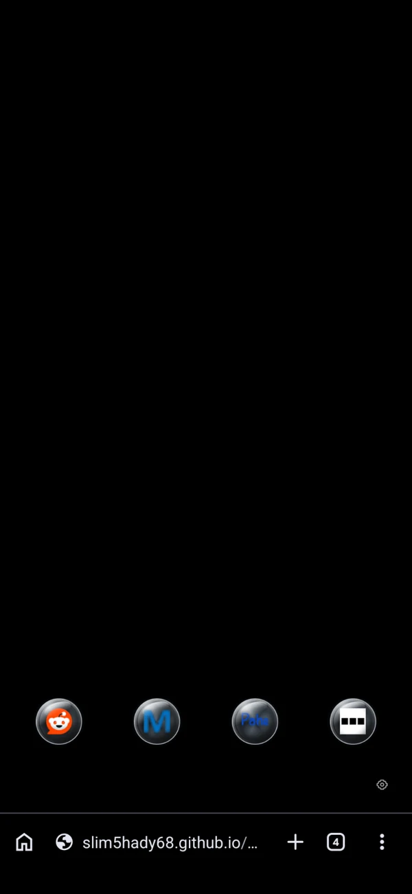
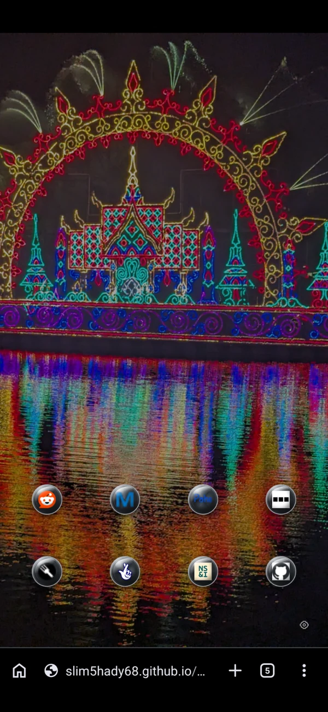
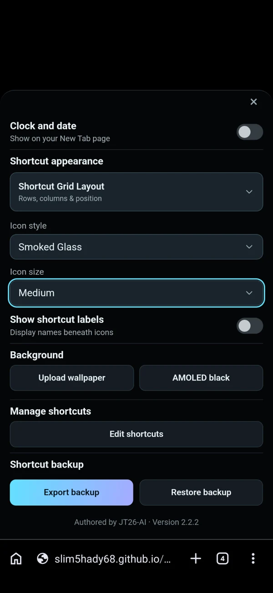
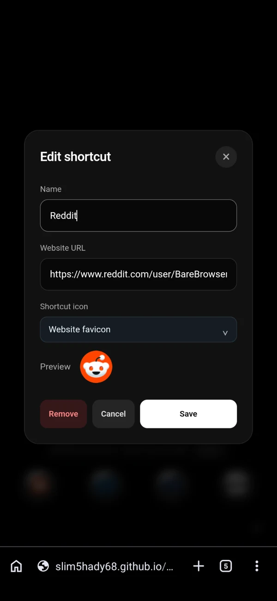

<h1 align="center">NTPure</h1>

<strong>Minimalist by design. Personalised by you.</strong>

  
  
  
  

A lightweight, customisable New Tab Page for a cleaner, more personal browsing experience. True-black AMOLED or your own wallpaper, with no built-in search bar or unnecessary clutter.

<a href="https://slim5hady68.github.io/NTPure/"><strong>Launch NTPure</strong></a> · <a href="https://github.com/Slim5hady68/NTPure/releases/latest">Latest release</a>

## Less clutter. More you.

  
  
  
  

Pure minimalism · Personal wallpapers · Intuitive settings · Custom shortcuts Tap any screenshot to enlarge.

## Getting started

**NTPure is a web-based page, not a browser extension.** To replace your browser’s New Tab Page, you need native support for custom New Tab URLs or a compatible extension.

### BareBrowser on Android

1. Install or enable the **Custom New Tab URL** extension.
2. Set its URL to `https://slim5hady68.github.io/NTPure/`.
3. Save and open a new tab.

### Other browsers

If your browser supports a custom homepage, you can use the same URL as your homepage. To replace the New Tab Page, use a compatible Custom New Tab extension if native support is unavailable. Browser and extension compatibility varies.

## Features

- **Three icon styles:** Floating (borderless), Uniform Rounded Tiles, and Smoked Glass with glossy reflections and dimensional shading.
- **Customisable shortcut icons:** Personalise each shortcut icon individually using its website favicon or your own PNG/JPG/WebP image.
- **Flexible shortcut grid:** Choose 4, 5 or 6 columns and 1, 2 or 3 rows, automatically stack rows upwards from the bottom and fine-tune the grid height with a vertical position slider, and adjust icon size and optional website labels.
- **Drag-and-drop ordering:** Press and hold a shortcut to rearrange it.
- **Optional clock and date:** Show or hide them in Settings.
- **Discreet settings panel:** A 12px grey cog opens a slide-up panel; close it using × or by tapping outside.
- **Backup and restore:** Export shortcuts, icon choices, uploaded icon images, wallpapers, and preferences to a JSON file.
- **Custom wallpaper:** Upload a JPG, PNG or WebP background image, and adjust its darkness with a slider; AMOLED black remains the default.
- **Local storage and caching:** Your setup stays in your browser, while service-worker caching can improve repeat load times.

## How to Use

### Add, edit, or remove shortcuts

- **Add:** Tap an empty **+** position, enter a website name and URL, then save.
- **Edit:** Open Settings → **Edit shortcuts**, then tap the shortcut you want to change. Tap **Done** to return to normal browsing.
- **Remove:** Open the shortcut editor and choose **Remove**.
- **Rearrange:** Press and hold a shortcut, move it to another position, then release.

### Choose a custom icon

In the shortcut editor, select an icon source:

1. **Website favicon** — use the website's automatically retrieved icon.
2. **Upload image** — choose a PNG, JPG, or WebP file from your device. NTPure resizes uploaded icons to 96 × 96 pixels and stores them locally.

You can switch back to the website favicon at any time. Uploaded icons are stored locally and can be included in your backups.

### Change the appearance

Tap the small grey cog in the bottom-right corner. Under **Icon style**, choose:

| Style | Appearance |
| --- | --- |
| **Floating** | Clean, borderless icons over any background |
| **Uniform Rounded Tiles** | Consistent rounded-square icon backgrounds |
| **Smoked Glass** | Glossy, smoky circular icons with highlights and depth |

Open **Shortcut Grid Layout** under **Shortcut appearance** to expand the layout controls. Choose **4, 5 or 6 columns**, **1, 2 or 3 rows**, and use the **Vertical position** slider to raise the shortcut grid from its default bottom position. Additional rows build upwards without moving the bottom row. Choosing fewer rows hides extra shortcuts without deleting them. Tap the layout box again to collapse it.

You can also change icon size, label visibility, and clock/date display. Your choices are saved automatically.

### Back up and restore

Open Settings and choose **Export backup** to download a JSON file. Use **Restore backup** to import a saved configuration.

Backups include your shortcut order, preferences, uploaded icon images, and wallpaper image data. **Restoring a backup replaces the current configuration**, so export your existing setup first if you want to keep it.

## Privacy and Storage

NTPure stores shortcuts, uploaded icons, and preferences locally in your browser using `localStorage`. Your personal shortcut configuration is not uploaded to GitHub.

Website favicons may be fetched from Google's favicon service.

Clearing browser site data can remove your saved shortcuts and settings. Keep a JSON backup, especially before changing browsers or clearing data.

## Custom Wallpapers

Open **Settings → Background** and tap **Upload wallpaper** to choose a JPG, PNG or WebP image from your device. Use the **Wallpaper darkness** slider (0–90%) to adjust its appearance, or select **AMOLED black** to remove the wallpaper.

There is no fixed 3 MB upload limit. Original images are saved when browser storage permits; larger images may be resized and compressed automatically to fit. Available browser storage still limits the saved image size. If resizing is blocked by your browser or storage is full, try a smaller image.

Wallpapers are stored locally in your browser and included in exported JSON backups. Keep a backup before clearing browser data.

## Release Highlights — v2.2.2 Final

- Bottom-anchored shortcut grid with automatic upward stacking.
- A single vertical position slider for a simpler layout.
- Wallpaper uploads without a fixed 3 MB limit.

## Credits

**NTPure v2.2.2 Final**  
**Authored by JT26-AI**  
**Icon concept credit: DrumDestroyer**

*Minimalist by design. Personalised by you.*

If you enjoy NTPure, consider giving the repository a star.
